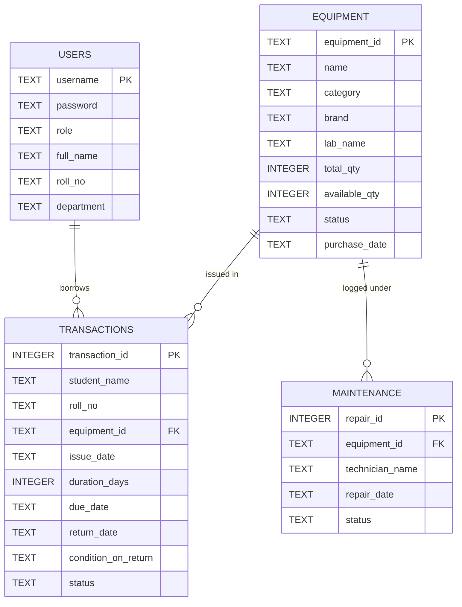

# 🔬 Laboratory Equipment Inventory Management System (LIMS)

[](https://lab-inventory-system-t5rxzik2kohqh7yl8l6qq5.streamlit.app/)


> **SIES Graduate School of Technology — Department of Information Technology**  
> An intelligent, role-based laboratory hardware inventory management platform designed to streamline component procurement, borrowing workflows, duration-based return deadline tracking, automated overdue alarms, maintenance lifecycles, and Project Bill of Materials (BOM) recommendations.

🌐 **Live Cloud Server:** [https://lab-inventory-system-t5rxzik2kohqh7yl8l6qq5.streamlit.app/](https://lab-inventory-system-t5rxzik2kohqh7yl8l6qq5.streamlit.app/)

---

## 📌 Table of Contents
- [Overview](#-overview)
- [Key Features & Modules](#-key-features--modules)
  - [1. Authentication & Role-Based Access Control](#1-authentication--role-based-access-control-rbac)
  - [2. Duration-Based Borrowing & Return Deadlines](#2-duration-based-borrowing--return-deadlines)
  - [3. Automated Deadline Alarms & Warning Engine](#3-automated-deadline-alarms--warning-engine)
  - [4. Laboratory Equipment Catalog & Full CRUD](#4-laboratory-equipment-catalog--full-crud)
  - [5. AI Lab Assistant & Project BOM Engine](#5-ai-lab-assistant--project-bom-engine)
  - [6. Real-Time Dashboard & Departmental KPIs](#6-real-time-dashboard--departmental-kpis)
  - [7. Maintenance & Hardware Damage Routing](#7-maintenance--hardware-damage-routing)
  - [8. Audit Reports & CSV Export](#8-audit-reports--csv-export)
- [Demo Credentials](#-demo-credentials)
- [Tech Stack](#-tech-stack)
- [System Architecture & Database Schema](#-system-architecture--database-schema)
- [Installation & Local Setup](#-installation--local-setup)
- [Project Directory Structure](#-project-directory-structure)
- [Contributing & Author](#-contributing--author)

---

## 📖 Overview

In academic and research laboratory environments, tracking microcontrollers, development boards, sensors, and passive components is often error-prone when handled on paper or static spreadsheets. **LIMS** provides a centralized, automated web platform that:
- Manages **78+ real IT Department components** across specialized labs (IoT Lab, Hardware Lab, Network Lab).
- Enforces academic borrowing duration limits (1 to 90 days) with automated deadline tracking.
- Alerts students and laboratory attendants of upcoming and overdue returns through real-time notifications, toast popups, and sidebar badges.
- Features an **AI Lab Assistant** to resolve component availability via natural language search and recommend full hardware Bill of Materials (BOMs) for mini and capstone projects.

---

## 🚀 Key Features & Modules

### 1. Authentication & Role-Based Access Control (RBAC)
- Multi-role permission architecture supporting **Students**, **Faculty**, and **Administrators**.
- **Student Self-Registration**: Verified signup verifying Roll Number / PRN and departmental assignments.
- Contextual navigation sidebar tailoring tools and views to authenticated credentials.

### 2. Duration-Based Borrowing & Return Deadlines
- **Preset Durations**: Quick selection for **1 Day** (urgent/overnight practical), **7 Days** (1-week standard practical), **30 Days** (1-month mini project), **60 Days** (2-month course project), and **90 Days** (maximum semester limit).
- **Custom Time Window**: Option to specify any exact custom borrowing duration between **1 and 90 days**.
- **Live Preview Calculation**: Dynamically computes and displays the return deadline date (`YYYY-MM-DD`) before submission.

### 3. Automated Deadline Alarms & Warning Engine
- **Intelligent Urgency Categorization**:
  - `🚨 Overdue by X days!` (Past deadline — critical alarm)
  - `⏰ Due Today!` (0 days remaining — critical notice)
  - `⚠️ Due in X days!` (1 to 3 days remaining — upcoming return warning)
  - `🟢 X days left` (> 3 days remaining — safe schedule)
- **Compact Notification System**:
  - **Left Sidebar Badge**: Quietly displays real-time pending alerts (`🚨 1 Overdue Item!`, `⚠️ 1 Item Due Soon!`).
  - **Issue Equipment Notice**: Consolidated summary card grouping multiple borrowed items (e.g. `10 K Pot × 7 units — Due in 1 day`) to prevent repetitive banners.
  - **Transient Toast Popup (`st.toast`)**: Automatically displays for a few seconds on page visit with a native `✕` cut button.
  - **Interactive Cut / Dismiss (`✕ Dismiss`)**: Allows students to dismiss the warning banner for their current session.

### 4. Laboratory Equipment Catalog & Full CRUD
- Browse 78+ IT hardware components categorized into Microcontrollers, Single Board Computers, Sensors, Actuators, and Passive Components.
- Real-time stock counts (`Total Qty` vs `Available Qty`).
- Multi-attribute filtering by Hardware Category, Lab Location, and Operational Status (Active, Under Repair, Retired).
- Complete CRUD operations (Add, Edit, Delete) for Admin and Faculty.

### 5. AI Lab Assistant & Project BOM Engine
- **Natural Language Hardware Search**: Normalizes conversational queries and utilizes fuzzy matching (`difflib`) to locate components and display immediate stock counts.
- **Project BOM Recommendations**: Bill of Materials for common projects (Smart Agriculture, Weather Stations, IoT Home Automation, Robotics, etc.).
- **One-Click Quick Issue**: Students can immediately issue required BOM components directly to their account with customizable duration options.

### 6. Real-Time Dashboard & Departmental KPIs
- Live scorecard metrics: Total Assets, Available Stock, Currently Issued, Overdue / Due Soon, Under Repair, and Low Stock (< 3 units).
- Visual charts: Interactive Donut Chart for asset status distribution and Bar Charts for category breakdowns.
- **Department Deadline Watch**: Audit table providing faculty and attendants with a comprehensive list of all active borrowings nearing deadline or overdue.

### 7. Maintenance & Hardware Damage Routing
- Verified return protocol with physical condition inspection (**Good**, **Damaged**, **Lost**).
- Items marked as **Damaged** automatically decrement inventory, update status to `Under Repair`, and open a maintenance ticket for technician assignment.
- Restoring repaired items automatically increments stock counts and resets status to `Active`.

### 8. Audit Reports & CSV Export
- Pre-built departmental compliance reports with one-click UTF-8 CSV downloads:
  1. Master Equipment Inventory
  2. Currently Borrowed Items (with Durations, Return Deadlines, and Urgency Status)
  3. Complete Returned History
  4. Damaged / Defective Items Log
  5. Maintenance Summary & Diagnostics
  6. Low Stock Reorder List (< 3 Units)

---

## 🔑 Demo Credentials

| Role | Username | Password | Privileges |
| :--- | :--- | :--- | :--- |
| **Student** | `student` | `student123` | Issue Equipment, View Borrowings & Deadlines, Catalog, AI Assistant |
| **Faculty** | `faculty` | `fac123` | Dashboard, Inventory Catalog, Issue & Return, Audit Reports, AI Assistant |
| **Admin** | `admin` | `admin123` | Full Access: CRUD, Maintenance & Repairs, Audit Reports, Dashboard |

*Note: New student accounts can also be created anytime directly via the **Student Sign Up** tab.*

---

## 🛠️ Tech Stack

- **Frontend & Web Framework**: [Streamlit](https://streamlit.io/)
- **Programming Language**: Python 3.9+
- **Database Engine**: SQLite3 (with automated safe migrations in `database.py`)
- **Data Analysis & Processing**: [Pandas](https://pandas.pydata.org/)
- **Visual Analytics & Plots**: [Matplotlib](https://matplotlib.org/)

---

## 📊 System Architecture & Database Schema



---

## 💻 Installation & Local Setup

### 1. Prerequisites
- Python 3.9 or higher installed on your system.
- Git installed.

### 2. Clone the Repository
```bash
git clone https://github.com/adiyx125/lab-inventory-system.git
cd lab-inventory-system
```

### 3. Create and Activate Virtual Environment (Recommended)
```bash
# Windows
python -m venv venv
.\venv\Scripts\activate

# macOS / Linux
python3 -m venv venv
source venv/bin/activate
```

### 4. Install Dependencies
```bash
pip install -r requirements.txt
```

### 5. Seed Database (Optional)
To initialize the SQLite database with baseline IT equipment and test borrowing records:
```bash
python seed_data.py
```

### 6. Run the Application
```bash
streamlit run app.py
```
Open your browser and navigate to `http://localhost:8501`.

---

## 📂 Project Directory Structure

```plaintext
lab-inventory-system/
├── .streamlit/
│   └── config.toml          # Streamlit theme & UI configurations
├── LIMS IMG/                # System screenshots and documentation assets
├── app.py                   # Main Streamlit web application & role views
├── database.py              # SQLite connection, queries, migrations & alarm engine
├── seed_data.py             # Database reset & initial hardware/user seeder
├── inventory.db             # Local SQLite database file
├── requirements.txt         # Python project dependencies
├── .gitignore               # Ignored build, cache, and binary files
└── README.md                # Project documentation
```

---

## 👤 Author & Acknowledgments

- **Author**: Aditya Yadav ([@adiyx125](https://github.com/adiyx125))
- **Institution**: SIES Graduate School of Technology, Navi Mumbai
- **Department**: Information Technology
